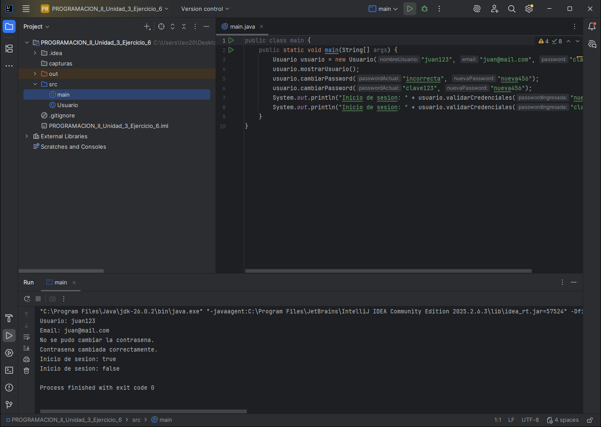

# PROGRAMACIÓN II — Unidad 3, Ejercicio 6: La Validación de Credenciales de Usuario

Trabajo práctico de Programación II. Este repositorio contiene la resolución en Java del ejercicio 6 de la Unidad 3.

## Consigna

#### Contexto

La seguridad en las aplicaciones modernas exige que las contraseñas de los usuarios nunca sean expuestas ni devueltas en texto plano a través de métodos de lectura genéricos. El principio de ocultación de información garantiza que los datos sensibles permanezcan protegidos dentro del objeto.

#### Consigna

Construir una clase en Java que gestione el perfil de un usuario, encapsulando su contraseña y permitiendo verificar su autenticidad sin revelarla.

#### Desarrollo requerido

- Definir la clase Usuario con atributos privados nombreUsuario, email y password.
- Proveer un método de modificación de clave cambiarPassword(String passwordActual, String nuevaPassword) que valide la contraseña anterior antes de permitir el cambio.
- Implementar un método de validación boolean validarCredenciales(String passwordIngresada) que verifique el acceso sin exponer el atributo privado.
- En el método main, crear un usuario, probar cambios de contraseña exitosos y erróneos, y verificar el inicio de sesión por consola.

## Estructura del repositorio

```
PROGRAMACION_II_Unidad_3_Ejercicio_6/
├── README.md
├── capturas/
│   └── consola.png
└── src/
    ├── main.java   # clase con el método main
    └── Usuario.java
```

## Funcionamiento y lógica

El ejercicio aplica **encapsulamiento** para proteger la contraseña de un usuario: no hay un getter que la devuelva, y solo se puede cambiar o validar a través de métodos controlados.

### `Usuario`

Tiene los atributos privados `nombreUsuario`, `email` y `password`.

- **`cambiarPassword(actual, nueva)`:** solo cambia la contraseña si la actual coincide y la nueva no está vacía. Informa el resultado y devuelve `true` o `false`.
- **`validarCredenciales(String)`:** compara la contraseña ingresada con la guardada y devuelve si coinciden, sin exponer la contraseña real.
- **`mostrarUsuario()`:** muestra el nombre de usuario y el email, pero no la contraseña.

### `main`

Crea al usuario **juan123** con la contraseña `clave123` y muestra sus datos. Después:

1. Intenta cambiar la contraseña con una actual incorrecta → no se cambia.
2. La cambia con la actual correcta a `nueva456` → se cambia.
3. Valida el inicio de sesión con `nueva456` → `true`.
4. Valida con la contraseña vieja `clave123` → `false`.

## Ejecución

Captura de la consola de IntelliJ IDEA ejecutando el programa:



Salida obtenida:

```
Usuario: juan123
Email: juan@mail.com
No se pudo cambiar la contrasena.
Contrasena cambiada correctamente.
Inicio de sesion: true
Inicio de sesion: false
```
